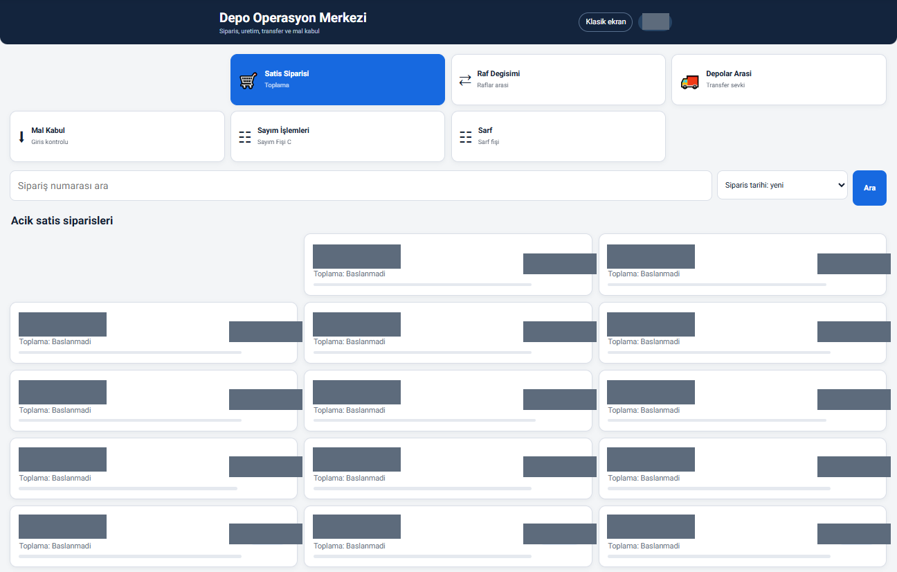
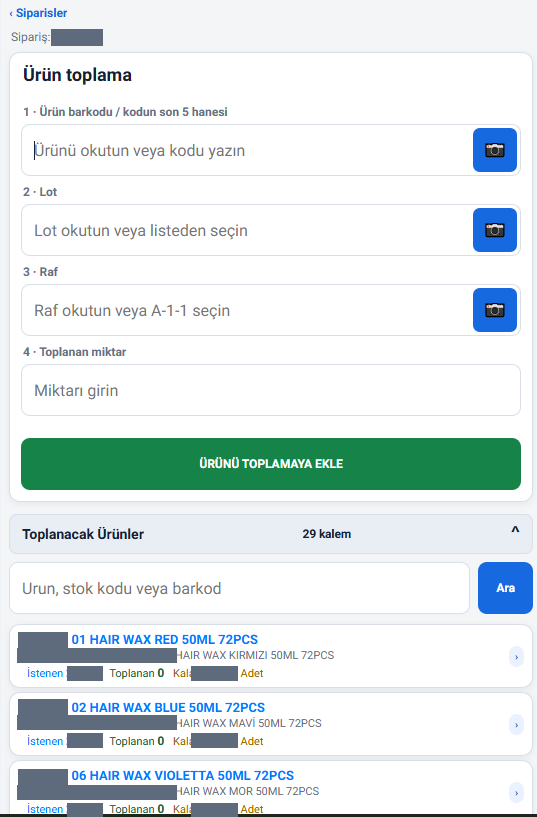
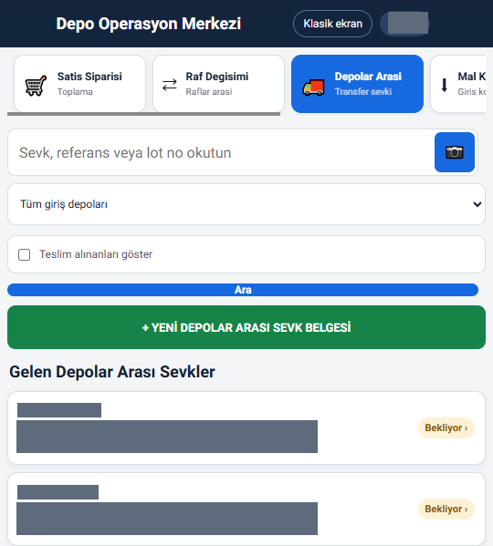
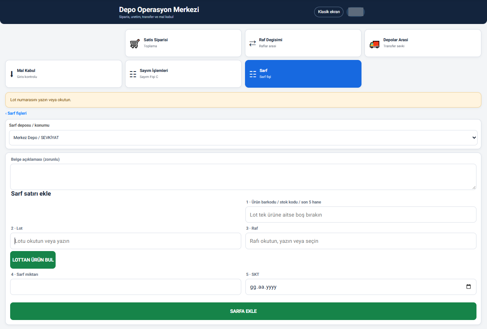

# Depo Operasyon Merkezi

Bu depo yönetimi (WMS) modülü, kurumumuzda kullandığımız Workcube ERP’ye entegre olarak geliştirildi. Depo ekiplerinin masaüstünden ve mobil terminallerden satış siparişlerini takip etmesini, ürünleri barkod, lot ve raf bilgileriyle toplamasını, depolar arası sevkleri yönetmesini, sayım yapmasını ve sarf fişi hazırlamasını sağlar.

Bu GitHub deposu yalnızca portföy amaçlıdır. Ekran görüntüleri anonimleştirilmiştir; kaynak kod, kurulum dosyaları ve çalıştırılabilir uygulama paylaşılmaz.

## Satış siparişleri

Açık siparişleri arama, sıralama ve toplama durumunu tek ekrandan takip etme.

## Ürün toplama

Ürün barkodu, lot, raf ve miktar bilgisiyle sipariş kalemlerini toplama.

## Depolar arası sevk

Sevk, referans veya lot numarasıyla arama; bekleyen ve teslim alınan sevkleri görüntüleme.

## Sarf

Lot numarasından ürün bulma, depo ve raf seçme, zorunlu belge açıklamasıyla sarf kaydı hazırlama.

